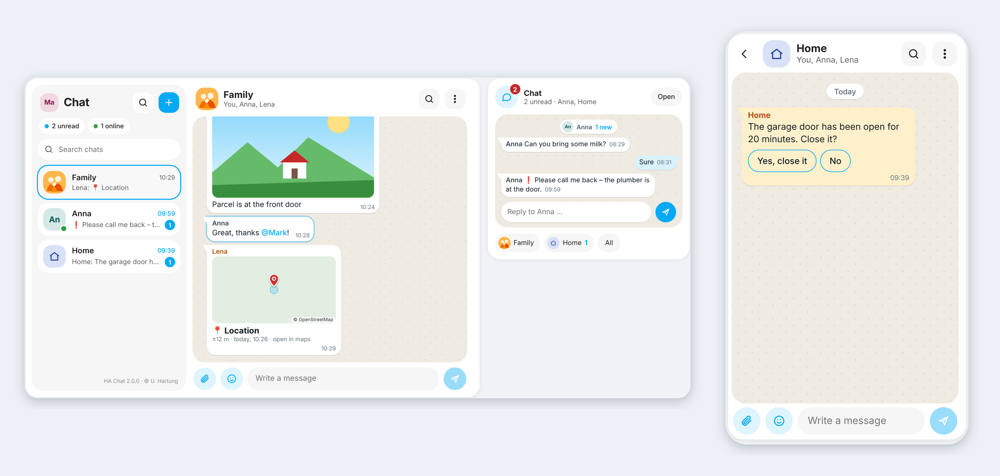
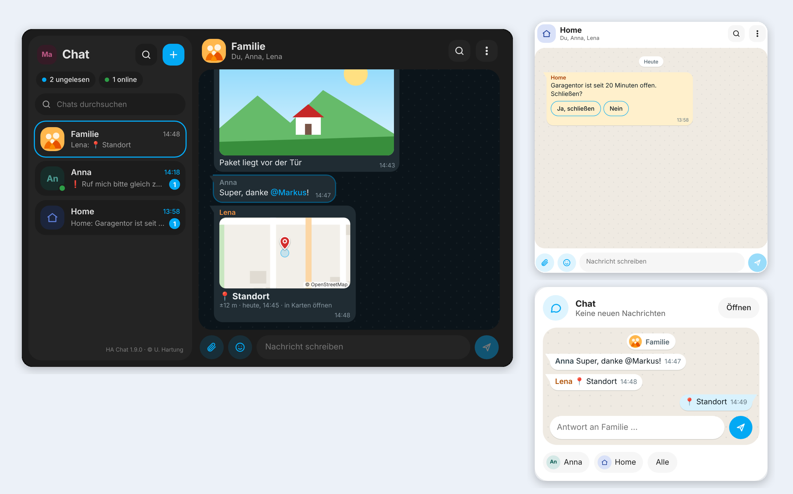
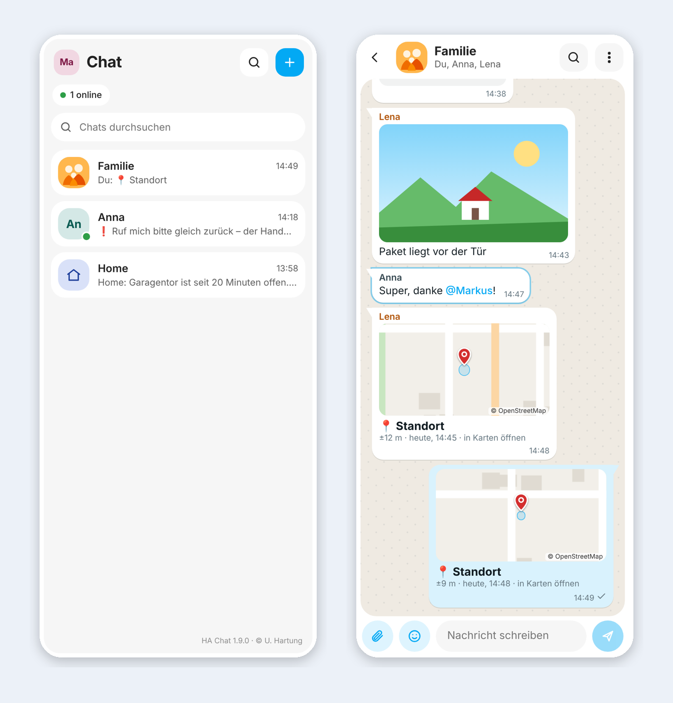

# HA Chat

**A private messenger for Home Assistant – for the family on the phone, tablet and PC. Fully local, no cloud.**

**[➜ Open in your Home Assistant Marketplace](https://my.home-assistant.io/redirect/marketplace_repository/?owner=uh-si&repository=ha-chat&category=integration)**



*Deutsche Beschreibung weiter unten.*

## Features

- **Chats like in a messenger app:** direct chats and groups (with picture and description) between Home Assistant users. Display names and profile pictures come from Home Assistant; everyone can set their own picture.
- **Photos, files and location:** camera and gallery (several at once, with preview and automatic resizing), drag & drop and paste, files, and your current location with accuracy and age.
- **Reactions, replies, editing, forwarding, @mentions, emoji picker, search** and a media overview per chat.
- **Read receipts** ("read by"), online status (can be switched off by everyone) and per-chat drafts.
- **Push notifications** through the Home Assistant Companion app (iOS and Android). Tapping a notification opens the right chat directly. Messages can be sent *with highest priority* (breaks through Focus / Do Not Disturb). Bursts are bundled to stay well below the daily push limit.
- **"Home" channel for automations:** Home Assistant writes into a shared channel or into a user's personal **"Home – Messages"** channel – with **answer buttons** (optionally with a confirmation such as "Sure?") that fire an event for your automations.
- **"Delete for me", clear history** and automatic clean-up after a configurable number of days.
- **Storage overview for administrators** (database, media, devices and push reachability).
- **Made for the phone:** the chat fills the screen, respects the notch and home indicator, no zooming into input fields on iOS.
- **English and German** – each user sees the card in the language of their Home Assistant profile (other languages fall back to English); push notifications follow it too.
- **Light and dark mode** – follows your Home Assistant theme and accent colour.
- **Compact tile** with unread count, the latest messages and a quick reply.





## Installation

Requires Home Assistant 2026.3 or newer. On Home Assistant 2026.11 and newer the Marketplace is built in.

1. Use the link at the top, or open **Settings → Marketplace**, choose **Add from link** and enter `https://github.com/uh-si/ha-chat`. Then select **Install** and restart Home Assistant.
2. Go to **Settings → Devices & services → Add integration**, choose **HA Chat** and select the users who may use the chat.
3. Edit a dashboard, select **Add card** and search for **HA Chat** (full chat) or **HA Chat – Kompakt** (tile). The card loads itself – no dashboard resource needed.

Both cards can be configured in the visual card editor. Users, message retention, push notifications and events can be changed later under **Settings → Devices & services → HA Chat → Configure**.

For push notifications each user needs the Home Assistant Companion app on their phone, logged in with their own Home Assistant user.

A detailed user guide (German) is in [`docs/Anleitung-HA-Chat.pdf`](docs/Anleitung-HA-Chat.pdf).

### Card options (YAML, all optional)

```yaml
type: custom:ha-chat-card
height: 600px        # height on PC/tablet; on phones the chat fills the screen
fit_screen: true     # false = keep "height" on phones too
language: en         # optional: en or de – default is the language of the user's profile
```

```yaml
type: custom:ha-chat-compact-card
title: Chat
messages: 3                     # number of latest messages shown
navigation_path: /ha-chat/chat  # open this dashboard instead of a pop-up
language: en                    # optional, as above
```

### Languages

The cards are available in **English** and **German**. By default each user sees them in the language set in their Home Assistant profile; any language other than German is shown in English. Use `language: en` or `language: de` to fix the language, e.g. on a shared wall tablet. Push notifications and error messages follow each user's language; errors from automations use the language of your Home Assistant instance. Messages themselves are not translated.

Want HA Chat in your language? Translations are welcome – see the `EN` table at the top of `custom_components/ha_chat/frontend/ha-chat-card.js` and `i18n.py`, and open a pull request.

## Automations

Send a message (into the shared "Home" channel, a named chat, or a user's personal "Home – Messages" channel):

```yaml
action: ha_chat.send_message
data:
  message: "The washing machine is done."
  # conversation: Family    # a chat by name or ID (default: "Home")
  # user: person.anna       # or: personal channel of this user (name, user ID or person)
  title: Laundry            # title of the push notification
  important: false          # true = highest priority
  buttons:
    - title: Done
      action: laundry_done
      confirm: Sure?        # optional confirmation before the press counts
response_variable: sent     # sent.message_id, sent.conversation_id
```

A button press fires the event `ha_chat_button` (`message_id`, `conversation_id`, `conversation_name`, `button`, `action`, `index`, `user_id`, `user_name`, `question`). New chat messages fire `ha_chat_message` (can be switched off in the options).

## Updates and your data

Updates are offered under **Settings → Updates**. Chats and media are stored in Home Assistant under `/config/ha_chat/` (SQLite database and media folder) and are kept on every update. After an update, close the Companion app completely once so that the new card is loaded – the version is shown at the bottom of the chat list.

## Uninstall

1. **Settings → Devices & services → HA Chat → Delete.** Your chats stay in `/config/ha_chat/`; delete that folder if you want to remove them as well.
2. In the **Marketplace**, open HA Chat and select **Remove**.

## Support

Please report problems and ideas in the [issue tracker](https://github.com/uh-si/ha-chat/issues).

This is a community project. It is not made, tested or supported by the Home Assistant project.

---

## Deutsch

**Ein privater Messenger für Home Assistant – für die Familie auf Handy, Tablet und PC. Komplett lokal, ohne Cloud.**

- **Chats wie im Messenger:** Einzel- und Gruppenchats (mit Bild und Beschreibung) zwischen den Home-Assistant-Benutzern, mit Anzeigenamen und eigenen Profilbildern.
- **Fotos, Dateien und Standort:** Kamera und Galerie (mehrere auf einmal, mit Vorschau und Verkleinern), Ziehen & Ablegen, Dateien und der eigene Standort mit Genauigkeit und Alter.
- **Reaktionen, Antworten, Bearbeiten, Weiterleiten, @Erwähnungen, Emojis, Suche** und Medien-Übersicht.
- **„Gelesen von“**, Online-Status (für jeden abschaltbar) und Entwürfe je Chat.
- **Push-Mitteilungen** über die Companion App (iOS und Android); Tippen öffnet direkt den richtigen Chat. Nachrichten lassen sich **mit höchster Priorität** senden (durch Fokus/„Nicht stören“).
- **Kanal „Home“ für Automationen**, dazu je Benutzer der persönliche Kanal **„Home – Messages“** – mit **Antwortknöpfen** (auf Wunsch mit Rückfrage „Sicher?“).
- **„Für mich löschen“, Verlauf leeren** und automatisches Aufräumen nach einstellbarer Zeit.
- **Speicher-Übersicht für Administratoren** (Datenbank, Medien, Geräte, Push-Erreichbarkeit).
- **Fürs Handy gemacht:** Der Chat füllt den Bildschirm und berücksichtigt Notch und Wischleiste.
- **Deutsch und Englisch** – jeder sieht die Karte in der Sprache seines Home-Assistant-Profils, fest einstellbar mit `language: de` oder `language: en`.
- **Hell- und Dunkelmodus** passend zum Home-Assistant-Design, dazu eine **kompakte Kachel**.

### Installation

1. Den Link oben verwenden oder **Einstellungen → Marketplace → Über Link hinzufügen** wählen und `https://github.com/uh-si/ha-chat` eingeben, dann **Installieren** und Home Assistant neu starten.
2. **Einstellungen → Geräte & Dienste → Integration hinzufügen → HA Chat** und die Benutzer auswählen, die chatten dürfen.
3. Dashboard bearbeiten → **Karte hinzufügen** → **HA Chat** (ganzer Chat) oder **HA Chat – Kompakt** (Kachel).

Updates erscheinen unter **Einstellungen → Updates**; Chats und Medien bleiben in `/config/ha_chat/` erhalten. Die ausführliche Bedienungsanleitung liegt unter [`docs/Anleitung-HA-Chat.pdf`](docs/Anleitung-HA-Chat.pdf).

## License

[MIT](LICENSE) – © 2026 U. Hartung
